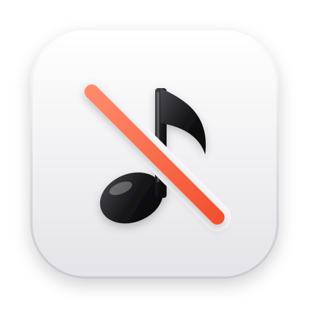

<div align="center">
  
  <h1>Tuneless</h1>
  <p>
    <strong>Stop Apple Music from opening on its own on macOS.</strong><br />
    No more Apple Music popping up when you connect AirPods or Bluetooth headphones, or press ▶︎ on your keyboard.
  </p>
  <p>
    <a href="https://github.com/nacholaciar/tuneless/releases"></a>
    <a href="https://github.com/nacholaciar/tuneless/actions/workflows/ci.yml"></a>
    
    
    <a href="LICENSE"></a>
  </p>
</div>

Tuneless is a tiny background service that quits Apple Music the instant it tries to launch. It has no window, no menu bar icon, no network access and no dependencies. Your media keys keep working, so ▶︎ / ⏸ / ⏭ still control YouTube Music, Spotify or any other player in your browser.

```bash
brew install nacholaciar/tap/tuneless
brew services start tuneless
```

## Why Tuneless?

macOS starts Apple Music whenever it receives a "play" command and no other app is playing audio. That happens when Bluetooth headphones or AirPods connect, when you press the Play key, or when you take an earbud out and put it back. If you do not use Apple Music, it is just noise.

- **Media keys keep working.** Unlike disabling `com.apple.rcd`, Tuneless does not touch the system's media-key routing.
- **No app to manage.** It is a LaunchAgent, not a menu bar app. Nothing to click, nothing in the Dock.
- **Small and auditable.** About 60 lines of Swift in [`Sources`](Sources). Read the whole thing in two minutes.
- **Private.** No network requests, no analytics, no settings files. It only quits `com.apple.Music` and `com.apple.iTunes`.
- **Idle at zero.** It sleeps on an AppKit notification and wakes only when an app launches.

## How it compares

| Approach | Stops Apple Music | Media keys work | Notes |
|---|:-:|:-:|---|
| Delete Music.app | ✗ | ✓ | Impossible: it lives on the sealed system volume protected by SIP. |
| `launchctl disable gui/$UID/com.apple.rcd` | ✓ | ✗ | Play/Pause stop reaching browsers and other players. |
| [noTunes](https://github.com/tombonez/noTunes) | ✓ | ✓ | Menu bar app; no code changes since 2024. |
| **Tuneless** | ✓ | ✓ | Background service, no UI, unit-tested, Swift 6. |

## Install

Requires macOS 14 Sonoma or later.

### Homebrew (recommended)

```bash
brew install nacholaciar/tap/tuneless
brew services start tuneless
```

Homebrew builds Tuneless from source and registers it as a login service.

### From source

Requires Swift 6 (Xcode 16 or later).

```bash
git clone https://github.com/nacholaciar/tuneless.git
cd tuneless
make install
```

`make install` builds a release binary, copies it to `~/.local/bin/tuneless`, writes `~/Library/LaunchAgents/io.github.nacholaciar.tuneless.plist` and starts it. Run it again after pulling changes to update.

## Usage

There is nothing to configure. Once the service is running, Apple Music is quit every time it opens.

| Task | Homebrew | From source |
|---|---|---|
| Check that it runs | `brew services info tuneless` | `make status` |
| Test it | `open -a Music` (it should close immediately) | `make smoke` |
| Pause it to use Apple Music | `brew services stop tuneless` | `make uninstall` |
| Remove it | `brew services stop tuneless && brew uninstall tuneless` | `make uninstall` |

Logs:

```bash
/usr/bin/log stream --predicate 'subsystem == "io.github.nacholaciar.tuneless"'
```

In zsh, `log` is a shell builtin, so use the full `/usr/bin/log` path.

## How it works

1. Tuneless subscribes to `NSWorkspace.willLaunchApplicationNotification`, and to `didLaunchApplicationNotification` as a fallback.
2. When the launching app's bundle identifier is `com.apple.Music` or `com.apple.iTunes`, it calls `forceTerminate()`, falling back to `SIGKILL`.
3. At start-up it also quits Apple Music if it is already open.
4. launchd starts it at login and restarts it if it ever exits (`KeepAlive`).

## FAQ

### Why does Apple Music open by itself when I connect AirPods or headphones?

When headphones connect, macOS sends a "play" command. The remote control daemon (`rcd`) forwards it to the app currently playing media. If none is, it launches Apple Music. Tuneless lets that happen and quits Apple Music before it gets in your way.

### Can I uninstall Apple Music on macOS?

No. Since macOS Big Sur, built-in apps live on a read-only, cryptographically sealed system volume. Removing Music.app requires disabling System Integrity Protection, and the next macOS update restores it anyway.

### Will my keyboard's Play, Pause and Next keys still work?

Yes. Tuneless does not disable `rcd`, so media keys on Apple keyboards, Logitech MX Keys and other keyboards keep controlling whatever is playing in your browser or another app.

### Is Tuneless an alternative to noTunes?

Yes. It uses the same public AppKit notification approach, runs as a background service instead of a menu bar app, and is written in Swift 6 with unit tests. Thanks to noTunes for the idea.

### Does it work with Apple Silicon and Intel Macs?

Yes. Homebrew and `make install` build it natively for your Mac.

### Does Apple Music flash on screen?

Sometimes, for a fraction of a second, before it is quit.

## Contributing

Contributions are welcome. Read [CONTRIBUTING.md](CONTRIBUTING.md), [CODE_OF_CONDUCT.md](CODE_OF_CONDUCT.md) and [SECURITY.md](SECURITY.md) before opening a pull request. Releases are automated with [Release Please](https://github.com/googleapis/release-please) from [Conventional Commits](https://www.conventionalcommits.org/).

## Licence

[MIT](LICENSE). Tuneless is not affiliated with Apple Inc. See [NOTICE.md](NOTICE.md).
